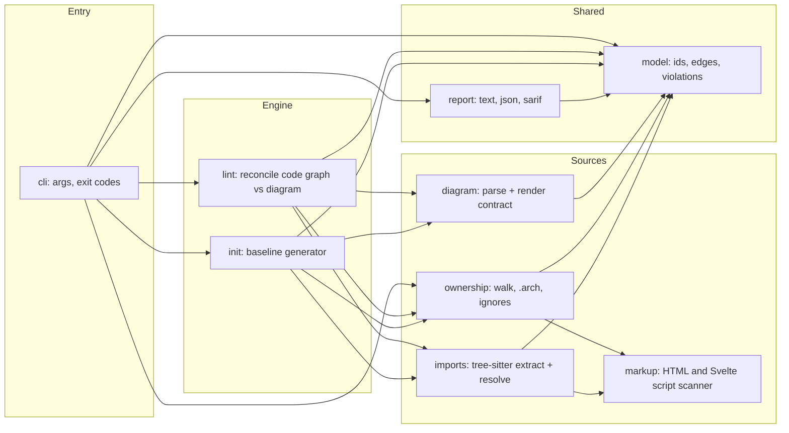

<p align="center"></p>

# driftwall

driftwall stops architecture drift. You draw your architecture as a small diagram. driftwall reads
your code and fails the build when the code depends on something the diagram does not allow.

> Status: early (0.x). Published on npm; the contract format may still change between minor versions.

## The idea

Architecture drifts when code starts using parts it was never meant to use. People do it by
accident, and AI coding agents do it faster. Nobody notices until the design is gone.

With driftwall you write the design down once, in a file called `architecture.mmd`. That file is
your **contract**. It is a small [Mermaid](https://mermaid.js.org/) diagram:

- Each box is a **component** (the diagram calls it a node): one part of your code with one job,
  such as `ui`, `api` or `db`.
- Each arrow is an **edge**: a dependency you allow. `ui --> api` means "`ui` may import from
  `api`".
- No arrow means no permission.

driftwall reads the imports in your code, works out which component each file belongs to, and
compares the two. Any import the diagram does not allow is an error, with the file and line. Run it
in CI or a pre-commit hook and the architecture stays what you drew.

## A small example

A project with three components. The contract allows `ui` to use `api`, and `api` to use `db`.
Nothing allows `ui` to use `db` directly.

```text
flowchart LR
  ui["ui: screens"]
  api["api: request handlers"]
  db["db: storage"]
  ui --> api
  api --> db
  %% map ui: src/ui/
  %% map api: src/api/
  %% map db: src/db/
```

The three `%% map` lines say which folder belongs to which component. They are Mermaid comments,
so the diagram still renders anywhere.

Now `src/ui/screen.ts` imports from `db`:

```ts
import { post } from "../api/handler";
import { save } from "../db/store";
```

```sh
driftwall lint .
```

```text
src/ui/screen.ts:2: error[undeclared-edge]: `ui` imports `db` (src/db/store.ts) but architecture.mmd declares no edge ui --> db
  hint: remove the import, or ask the user to approve adding the edge to the contract
driftwall: 1 error, 0 warnings
```

The exit code is 1, so CI fails. Remove the import (or, if the design really changed, add
`ui --> db` to the contract on purpose) and it passes:

```text
driftwall: clean
```

## Install

With npm:

```sh
npm install --global driftwall
```

Or run it once without installing: `npx driftwall lint .`

Prebuilt binaries for macOS and Linux (x86_64 and arm64) are on the
[releases page](https://github.com/phanshiyu/driftwall/releases), along with a shell installer.
To build from source you need Rust 1.90 or newer:

```sh
cargo install --git https://github.com/phanshiyu/driftwall
```

Windows is untested. See [docs/RELEASING.md](docs/RELEASING.md) for how releases are made.

## Quick start

Inside an existing repository:

```sh
driftwall init . --map
driftwall lint . --strict
```

`init` reads your code and writes a first `architecture.mmd`, with `%% map` lines that tie folders
to components. The draft lints clean at once because it declares every dependency the code already
has. That is a snapshot, not a design. Open the file, then:

1. Merge or rename components until each one has a single job.
2. Delete arrows you do not want. Lint will now report the code that breaks them.
3. Fix that code, or leave it as visible debt.

Add `driftwall lint .` to CI or a pre-commit hook. Exit codes: `0` clean, `1` violations, `2` the
tool itself failed (bad diagram syntax, unreadable file, bad arguments).

### Adopting on a repo with existing debt

A contract that leaves existing debt undeclared makes `lint` fail until it is all fixed. Record the
debt once, then fail CI only on new debt:

```sh
driftwall lint . --write-baseline driftwall-baseline.txt
driftwall lint . --baseline driftwall-baseline.txt --strict
```

The baseline counts findings per key, so debt cannot grow inside an entry that is already recorded.
Fixing debt never fails; with `--strict`, an entry that has room to spare is a `stale-baseline`
warning until you shrink the file by writing it again. `driftwall diff --base main --baseline
driftwall-baseline.txt --exit-code` lets a reviewer see, and CI require approval for, debt added.
See [Debt baseline](docs/DESIGN.md#debt-baseline).

## Languages

driftwall reads imports in TypeScript, JavaScript, Python, Rust, Swift, shell, Svelte and HTML
files that have a `<script>` element. Other files are not read. The exact file extensions are in
[Source languages by file](docs/DESIGN.md#source-languages-by-file).

## Commands

| Command | What it does |
| --- | --- |
| `driftwall lint [PATH]` | Check the code against the contract. Flags: `--contract FILE`, `--format text\|json\|sarif`, `--strict` (warnings fail too), `--baseline FILE`, `--write-baseline FILE`. |
| `driftwall init [PATH]` | Write a first contract for an existing repository. Flags: `--depth N`, `--contract FILE`, `--map`, `--no-tags`, `--force`. |
| `driftwall where FILE` | Show which component owns a file, and why. Flags: `--root DIR`, `--contract FILE`, `--format text\|json`. |
| `driftwall brief [PATH]` | Print the whole architecture and its current state. Made for agents. Flags: `--contract FILE`, `--format text\|json`. |
| `driftwall neighbors NODE [PATH]` | Print one component with every edge in or out, and the file and line of each import. Flags: `--contract FILE`, `--format text\|json`, `--files`, `--all-sites`. |
| `driftwall diff --base REF [PATH]` | Show how the contract changed since a git ref, so a human can review it. Flags: `--contract FILE`, `--format text\|json`, `--exit-code` (exit 1 on any change), `--baseline FILE` (also report debt added). |
| `driftwall render [PATH]` | Print a generated Mermaid picture of the contract, from the contract alone. Flags: `--contract FILE`, `--depth N` (boundaries at depth N as one box each), `--focus BOUNDARY` (one boundary in full, the rest as boxes), `--short-labels` (labels cut at the first `:`), `--update FILE.md` and `--check FILE.md` (keep `<!-- driftwall render -->` blocks of a Markdown file current; `--check` exits 1 when one is stale). |

To keep an overview in your docs that cannot drift, put a block in a Markdown file and let CI check
it ([Contract picture](docs/DESIGN.md#contract-picture)):

```md
<!-- driftwall render --depth 1 -->
<!-- driftwall render end -->
```

```sh
driftwall render --update docs/architecture.md   # fills every block with a ```mermaid picture
driftwall render --check docs/architecture.md    # in CI: exits 1 naming each stale block
```

Run `driftwall <command> --help` for the details. Output for the example above:

```sh
driftwall where src/ui/screen.ts
```

```text
src/ui/screen.ts: ui (via architecture.mmd:7 (map src/ui/))
```

```sh
driftwall brief .
```

```text
driftwall: 3 nodes, 2 edges (2 implemented, 0 planned), 1 error, 0 warnings
nodes:
  api: src/api/ (1 file)
  db: src/db/ (1 file)
  ui: src/ui/ (1 file)
edges:
  api --> db (1 import) uses: save
  ui --> api (1 import) uses: post
  ui --> db (1 import) UNDECLARED uses: save
blind spots: none
```

```sh
driftwall neighbors api .
```

```text
node: api
label: api: request handlers
dirs: src/api/
files: 1
outgoing:
  api --> db (1 import) uses: save
    src/api/handler.ts:1
incoming:
  ui --> api (1 import) uses: post
    src/ui/screen.ts:1
blind spots: none
```

## What you can write in a contract

Every line is a Mermaid edge or a Mermaid comment, so the file still renders as a diagram. Full
syntax and behaviour are in [docs/DESIGN.md](docs/DESIGN.md).

| Write | Meaning | Reference |
| --- | --- | --- |
| `a --> b` | `a` may depend on `b`. An arrow with no import behind it is a warning. | [Contract format](docs/DESIGN.md#contract-format) |
| `a -.-> b` | Planned dependency, allowed until built. | [Contract format](docs/DESIGN.md#contract-format) |
| `features --> core` | An end may be a subgraph: every node in `features` may depend on every node in `core`. Works with every arrow here. | [Boundary edges](docs/DESIGN.md#boundary-edges) |
| `a -->\|test\| b` | `a` may use `b` from test code only. | [Test edges](docs/DESIGN.md#test-edges) |
| `a -->\|type\| b` | `a` may use `b`'s types, not its runtime code. | [Type edges](docs/DESIGN.md#type-edges) |
| `%% map ui: src/ui/` | Map files to a component, with no extra files. (`.arch` tag files still work.) | [Contract map](docs/DESIGN.md#contract-map--map) |
| `%% exports api: post` | Only these names of `api` may be imported from outside. | [Symbols and public surfaces](docs/DESIGN.md#symbols-and-public-surfaces) |
| `%% order: entry > engine > shared` | Layers, top to bottom. Imports may not point upward, even with no arrow drawn. | [Layer order](docs/DESIGN.md#layer-order) |
| `%% order open: app > features > core` | Open layers: each layer may use any layer below with no arrow. An arrow from a layer to a lower one limits that pair of layers to the arrows you draw. | [Open order](docs/DESIGN.md#open-order) |
| `%% deny ui: core` | In an open chain, `ui` may never use `core`, though the chain allows it. An import is `denied-edge`, and an arrow for the pair is an error. | [Denial](docs/DESIGN.md#denial) |
| `%% isolated: features` | The children of `features` (feature boundaries nested inside it, or nodes in it) may not depend on each other, and no arrow can allow it. Subgraphs may nest. | [Isolated boundaries](docs/DESIGN.md#isolated-boundaries), [Nested boundaries](docs/DESIGN.md#nested-boundaries) |
| `%% each features: controller --> service` | The same arrows inside every feature of `features`, written once: each child boundary `billing` gets `billing-controller --> billing-service`, skipped where it lacks a part. An end may also be a declared id: `view --> ui` lets only the view of each feature use `ui`. A role no feature has is an error. | [Edge templates](docs/DESIGN.md#edge-templates) |
| `%% no-cycles` | The declared arrows may not form a cycle. | [No cycles](docs/DESIGN.md#no-cycles) |
| `%% budget lint: fan-out 5, files 20, interface 8` | Warn when a component grows past a limit (`fan-out`, `files`, `lines`, `interface`: how many of its symbols other components use). | [Budgets](docs/DESIGN.md#budgets) |
| `%% tests: isolated` | Production code may not import test files. | [Test isolation](docs/DESIGN.md#test-isolation) |
| `%% facade ui-lib` | Callers of a re-exporting module depend on it, not on what it re-exports. | [Re-exports](docs/DESIGN.md#re-exports) |
| `%% packages db: sqlx` | A component may use only these outside packages. | [Package rules](docs/DESIGN.md#package-rules) |
| `%% forbid-packages domain: subprocess, askama` | A component may never use these packages. Write a name as the code imports it: `subprocess` for Python, `askama` or `serde_json` for a Rust crate. | [Package rules](docs/DESIGN.md#package-rules) |

Every kind of finding, with its severity, is listed in
[Rules (violation kinds)](docs/DESIGN.md#rules-violation-kinds). `lint` prints `text`, `json`
(stable, for agents) or `sarif` (for code scanning).

## Use it with AI coding agents

Agents drift fastest, so give them the contract up front and check their work:

- `driftwall brief` prints the architecture in one call, and `driftwall neighbors NODE` zooms in
  on one component.
- `driftwall lint . --format json` gives machine-readable findings with file and line.
- [integrations/claude-code](integrations/claude-code) holds a Claude Code skill and hooks. One
  injects the contract at session start. One blocks the agent from finishing while lint fails.

## This repository follows its own contract

driftwall was designed diagram first, and this repository is checked against the diagram below on
every commit. The pre-commit gate and CI both run `driftwall lint .`, and a test fails if the
diagram stops matching [`architecture.mmd`](architecture.mmd).

<!-- architecture:start -->

<!-- architecture:end -->

## Learn more

- [docs/DESIGN.md](docs/DESIGN.md): the full specification and rule reference.
- [docs/dogfood/README.md](docs/dogfood/README.md): driftwall used on nine real repositories.
- [docs/RELEASING.md](docs/RELEASING.md): how releases are built.
- [CHANGELOG.md](CHANGELOG.md): what changed.

## License

[MIT](LICENSE).
