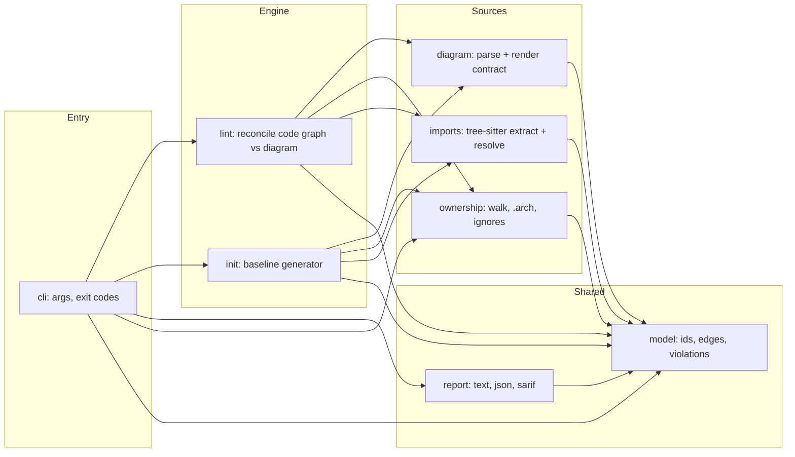

<p align="center"></p>

# driftwall

Your architecture diagram is the contract. driftwall fails the build when the code drifts from it.

> Status: proof of concept under construction. This repo is built diagram-first: see
> [`architecture.mmd`](architecture.mmd) for the contract this codebase is held to, and
> [`docs/DESIGN.md`](docs/DESIGN.md) for the design.


## Built with its own contract

driftwall was written diagram first. Every module below was declared here, with its allowed
dependencies, before any code existed. Once the tool could read its own Rust, it began enforcing
this diagram on itself: `driftwall lint . --strict` on this repository prints `driftwall: clean`,
and both the pre-commit gate and CI fail if the code and the diagram ever disagree.

<!-- architecture:start -->

<!-- architecture:end -->

Solid arrows are dependencies the code uses and must keep declaring. A dotted arrow would be a
dependency declared ahead of the code. The diagram above is copied verbatim from
[`architecture.mmd`](architecture.mmd), and a test fails if the two drift apart.

- `architecture.mmd` declares nodes and the dependencies allowed between them.
- `.arch` files tag directories with a node.
- `driftwall lint` finds unmapped files, unknown nodes and undeclared dependencies, with file and
  line, in text, JSON or SARIF.
- Built for AI agents: a deterministic map of where code lives and what may depend on what.

## Install

Not published yet. See [docs/RELEASING.md](docs/RELEASING.md). Until then:

```
cargo install --git https://github.com/phanshiyu/driftwall
```

## Use

```
driftwall init            # baseline architecture.mmd and .arch tags from the existing code
driftwall lint            # exit 0 clean, 1 violations, 2 tool error
driftwall lint --format json
driftwall where src/foo.ts
```

Agent integration (Claude Code skill and hooks): [integrations/claude-code](integrations/claude-code).
